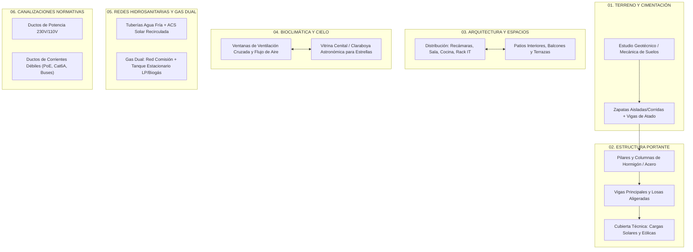

# Fase 0: Diseño Arquitectónico, Estructural, Geotécnico e Instalaciones Base (MEP)

## 1. Visión General y Alcance
Este directorio centraliza los fundamentos de ingeniería civil, geotecnia, diseño arquitectónico bioclimático e infraestructura de redes hidrosanitarias y canalizaciones de la vivienda domótica autosustentable.

Garantiza que la construcción soporte de forma nativa e integrada:
1. Las cargas mecánicas y dinámicas de los sistemas renovables (torre del aerogenerador Archimedes MK9, bancada de paneles solares fotovoltaicos y termotanque solar acumulador en cubierta).
2. Los espacios habitables de máximo confort, ventilación cruzada natural y observación celeste mediante una cúpula/vitrina astronómica cenital.
3. El trazado segregado y normado de fluidos (agua fría, caliente solar ACS, gas natural de compañía y gas de tanque estacionario de respaldo) y de canalizaciones eléctricas de fuerza y datos.

---

## 2. Mapa de Módulos de Diseño
- **[`01_mecanica_suelos_y_cimentacion/`](01_mecanica_suelos_y_cimentacion/)**: Ensayos de penetración estándar (SPT), capacidad portante admisible, nivel freático, diseño y armado de zapatas y vigas riostras.
- **[`02_estructura_pilares_y_losas/`](02_estructura_pilares_y_losas/)**: Columnas, vigas de carga, losas de entrepiso y cubierta dimensionadas para sobrecargas dinámicas de aerogenerador y paneles.
- **[`03_arquitectura_habitaciones_patios_terrazas/`](03_arquitectura_habitaciones_patios_terrazas/)**: Planimetría general, zonificación acústica/térmica, cuarto técnico para rack IT y baterías, integración de terrazas y patios verdes.
- **[`04_bioclimatica_ventilacion_lucernario_celeste/`](04_bioclimatica_ventilacion_lucernario_celeste/)**: Dinámica de fluidos por efecto chimenea, ventanas termoacústicas oscilobatientes y claraboya/vitrina cenital para observación estelar y luz natural.
- **[`05_instalaciones_hidraulicas_y_gas/`](05_instalaciones_hidraulicas_y_gas/)**: Trazado en polipropileno reticulado (PEX/PPR) para agua, red dual de gas (tubería de red urbana + tanque estacionario/biogás) con reguladores y electroválvulas.
- **[`06_canalizaciones_y_ductos_electricos_normativa/`](06_canalizaciones_y_ductos_electricos_normativa/)**: Trazado independiente con distancia mínima de seguridad de 20-30 cm entre potencia y telecomunicaciones según normas NEC/REBT/NOM-001-SEDE.
