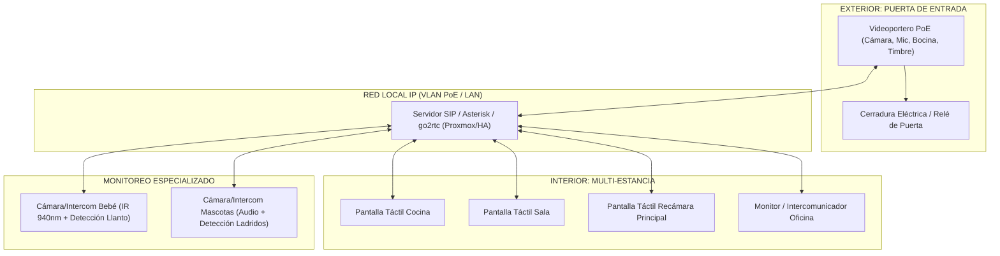

# Sistema de Intercomunicación Integral Residencial, Videoportero y Monitoreo Especializado

## 1. Descripción y Alcance
Este subsistema unifica la red de comunicación por voz, vídeo y control de accesos de toda la vivienda, conectando tres niveles estratégicos bajo una misma plataforma local (SIP / WebRTC / Home Assistant):
1. **Acceso Principal Exterior:** Videoportero de entrada con cámara HD/4K gran angular, pulsador de llamada iluminado, audio bidireccional y control de cerradura.
2. **Intercomunicación Multi-Zona Interior (Cuarto a Cuarto):** Pantallas táctiles inteligentes empotradas en pared y de sobremesa distribuidas en estancias clave (Cocina, Recámara Principal, Sala, Oficina, Pasillos) para llamadas directas, difusión general (*All-Call / Broadcast*) y control domótico.
3. **Monitoreo Especializado de Bebés y Mascotas:** Terminales de dormitorio con visión nocturna infrarroja invisible (940 nm), detección acústica de llanto/ladridos por IA, reproducción de audio relajante y privacidad física.

---

## 2. Requerimientos de Diseño Mecánico (`mecanico/`)

### 2.1. Videoportero de Entrada Exterior
- **Carcasa Antivandálica y Climatizada:** Aleación de aluminio mecanizado o acero inoxidable con grado de protección **IP65/IP66** contra lluvia y polvo, e **IK08/IK09** contra impactos.
- **Montaje:** Caja de empotrar en muro de fachada o caja de superficie con visera protectora contra la lluvia y parasol antireflejos.
- **Pulsador de Timbre:** Botón metálico de carrera corta con retroiluminación perimetral LED de estado (espera, llamada en curso, apertura concedida).

### 2.2. Pantallas e Intercomunicadores de Pared y Sobremesa (Multi-Estancia)
- **Terminales de Pared (Cocina, Sala, Pasillo, Recámaras):**
  - Soporte de montaje a ras de pared compatible con cajas de empotrar estándar (tipo 503 o cajas cuadradas de 86x86 mm / 100x100 mm).
  - Pantallas multitáctiles IPS de 7" a 10" con cristal templado de borde a borde y marco de aluminio ultraplano.
- **Terminales de Sobremesa (Oficina, Mesilla de Noche):**
  - Soporte de base inclinada a 65° con almohadillas antideslizantes de silicona.
  - Gestión oculta del cable de alimentación/red a través de la base.

### 2.3. Cámaras Intercomunicadoras de Bebés y Mascotas
- **Soportes Articulados:** Abrazadera engomada de seguridad para cunas, rótula esférica multidireccional de 360° y placa magnética para montaje rápido en pared sin perforaciones invasivas.
- **Obturador Mecánico de Privacidad (*Privacy Shutter*):** Cubierta física deslizable sobre el lente y microinterruptor que desconecta físicamente las líneas de datos del micrófono.
- **Construcción Silenciosa:** Carcasa con disipación de calor 100% pasiva sin ranuras con ventiladores que acumulen polvo o generen zumbidos en dormitorios infantiles.

---

## 3. Requerimientos de Diseño Eléctrico y Protecciones (`electrico/`)

### 3.1. Alimentación y Cableado
- **Alimentación Principal PoE (Power over Ethernet):**
  - Conexión mediante estándar **IEEE 802.3af/at (48V)** a través de cables UTP Cat6A blindados directos desde el switch PoE gestionado del rack central.
  - Elimina transformadores locales voluminosos detrás de cada pared.
  - **Continuidad Eléctrica:** Cada pantalla e intercomunicador queda respaldado automáticamente por la **UPS Online de doble conversión** del rack IT; el sistema sigue funcionando ante apagones.
- **Opción Secundaria USB-C PD / 12V DC:** Alimentación auxiliar para terminales de sobremesa mediante fuentes con aislamiento galvánico de alta frecuencia y baja emisión de ruido electromagnético.

### 3.2. Subcircuito de Audio Profesional y Micrófonos
- **Cancelación Activa de Ruido (AEC & NR):** Procesador de señal digital (DSP) integrado para cancelación de eco acústico y reducción de ruido de viento en el videoportero exterior.
- **Micrófonos:** Arreglo dual de micrófonos MEMS para captura direccional de voz y captación uniforme en habitaciones.
- **Altavoces:** Bocinas de neodimio de 3W a 5W con amplificador clase D de alta eficiencia y baja distorsión armónica (THD < 1%) para garantizar inteligibilidad perfecta en la voz.

### 3.3. Vídeo e Infrarrojos No Invasivos
- **Videoportero Exterior:** Sensor CMOS con HDR/WDR dinámico (mínimo 120 dB) para evitar contraluces solares y LEDs blancos de cortesía para visión nocturna a color.
- **Cámaras de Bebés y Mascotas:** Sensor ultraluz con LEDs infrarrojos de **longitud de onda de 940 nm** (completamente invisibles a simple vista, evitando el destello rojo de los 850 nm que despierta a bebés o incomoda a mascotas).

### 3.4. Interfaces de Control y Cerraduras
- **Contacto de Relé Integrado (Dry Contact):** Salida a relé libre de potencial en el videoportero para activación directa de la cerradura eléctrica / electroimán de la puerta peatonal o portón vehicular, con protección por diodo flyback / varistor contra arcos inductivos.

---

## 4. Requerimientos de Control, Protocolos y Automatización (`control/`)

### 4.1. Arquitectura de Comunicaciones (SIP + WebRTC)
- **Servidor PBX / SIP Local (Asterisk / FreePBX / go2rtc en Proxmox):**
  - Cada terminal (videoportero, pantallas de cocina, sala, recámaras y oficina) opera como una extensión SIP local cifrada (TLS/SRTP).
  - Enlace con **go2rtc** en Frigate/Home Assistant para streaming WebRTC instantáneo (<150 ms de retardo).
- **Funcionalidades de Comunicación:**
  - **Llamada de Puerta:** Al pulsar el timbre exterior, repican simultáneamente las pantallas seleccionadas y los teléfonos móviles (vía VPN). Al responder, se establece vídeo bidireccional y se habilita el botón de "Abrir Puerta".
  - **Llamada Cuarto a Cuarto (*Room-to-Room*):** Comunicación privada bidireccional directa entre habitaciones (ej. Cocina con Oficina).
  - **Difusión General (*All-Call / Intercom Broadcast*):** Emisión de mensajes de voz unidireccionales a toda la vivienda (ej. "La comida está lista" o alarmas técnicas de emergencia).
  - **Modo No Molestar (DND):** Programación horaria para silenciar llamadas en dormitorios durante la noche.

### 4.2. Detección Acústica y Visual por Inteligencia Artificial
- **Monitoreo de Bebés (*Baby Cry Detection*):**
  - Inferencia de audio local con modelos TensorFlow Lite (YAMNet) que detecta el patrón específico del llanto de un bebé.
  - Disparo de aviso con audio prioritario en el monitor de los padres y activación de luz de cortesía al 10% en el dormitorio.
- **Monitoreo de Mascotas (*Pet Sound & Motion Detection*):**
  - Clasificación de ladridos continuos, maullidos, aullidos o ruidos de rotura.
  - Alerta en pantalla de oficina o sala y opción de hablarles en tiempo real para tranquilizarlas.

### 4.3. Dashboard Domótico Integrado en Pantallas
- Las pantallas de pared y sobremesa funcionan de manera nativa como paneles táctiles de Home Assistant:
  - Visualización del estado del sistema solar, nivel de batería y consumo eléctrico instantáneo.
  - Control de iluminación, termostatos de clima, persianas y activación del modo "Fuera de Casa".

---

## 5. Estructura de este Directorio
- `mecanico/`:
  - [`videoportero_carcasa.FCStd`](./mecanico/videoportero_carcasa.FCStd): Modelo paramétrico 3D en FreeCAD 1.1+ de la carcasa antivandálica exterior con visera antilluvia a 15°, orificio de lente M12, botón de 19 mm y rejilla acústica.
  - [`videoportero_carcasa.step`](./mecanico/videoportero_carcasa.step): Modelo universal STEP AP214 para mecanizado CNC en aluminio o impresión 3D en PETG/ABS.
- `electrico/`:
  - [`videoportero_esp32s3.kicad_pro`](./electrico/videoportero_esp32s3.kicad_pro) y [`videoportero_esp32s3.kicad_sch`](./electrico/videoportero_esp32s3.kicad_sch): Proyecto y esquemático en KiCad 10.0 con ESP32-S3, cámara DVP, audio I2S (INMP441 + MAX98357A), driver MOSFET para cerradura 12V 2A y PoE.
  - [`videoportero_esp32s3.svg`](./electrico/esquema_svg/videoportero_esp32s3.svg): Exportación vectorial de alta definición del circuito electrónico.
  - [`BOM.md`](./electrico/BOM.md): Lista completa de materiales y componentes para ensamble del videoportero.
- `control/`:
  - [`esp32s3_doorbell.yaml`](./control/esp32s3_doorbell.yaml): Firmware ESPHome para videoportero de entrada con cámara, audio dúplex I2S, timbre y control de cerradura.
  - [`go2rtc.yaml`](./control/go2rtc.yaml): Streaming WebRTC de ultrabaja latencia (<200 ms) y transcodificación de audio bidireccional hacia Home Assistant.
  - [`intercom_baby_monitor.yaml`](./control/intercom_baby_monitor.yaml): Firmware ESPHome para monitor de cuna y mascotas con LEDs IR de 940 nm invisibles, micrófono I2S y sensor higrotérmico SHT40.
- [`NOTA_DE_DISENO.md`](./NOTA_DE_DISENO.md): Memoria de cálculo de enlaces SIP/WebRTC, anchos de banda, SPL acústico y aislamiento IP65.
