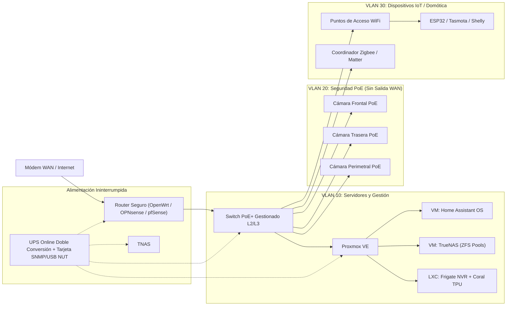
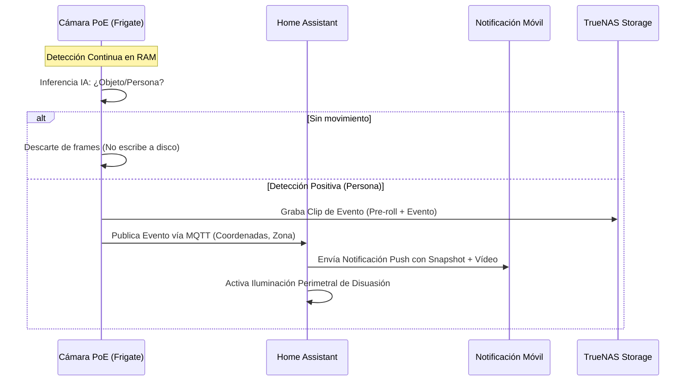
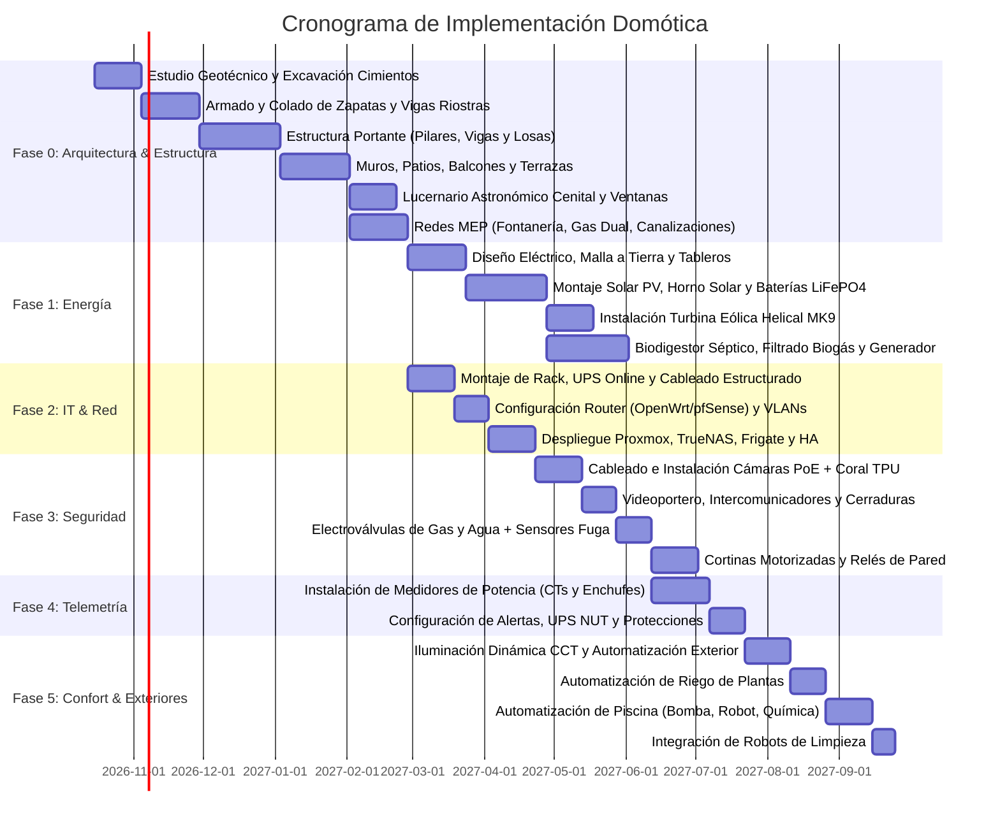

# Plan Maestro y Objetivos del Proyecto: Domótica Integral Autosustentable

> **Estado del Proyecto:** En Planificación y Especificación Técnica  
> **Núcleo de Automatización:** Home Assistant (Supervised / Container bajo Proxmox VE)  
> **Enfoque Principal:** Resiliencia y Autosuficiencia Energética (Off-Grid / Híbrido), Seguridad Perimetral Avanzada, Monitorización Eléctrica Granular y Confort Automatizado.

---

## 1. Visión General del Proyecto

El objetivo principal es diseñar, implementar e integrar un ecosistema domótico e industrial-residencial que combine:
1. **Diseño Arquitectónico, Estructural, Geotécnico e Instalaciones Base (Fase 0):** Mecánica de suelos, cálculo de zapatas y pilares aptos para sobrecargas renovables, zonificación bioclimática con ventilación cruzada natural, vitrina/lucernario astronómico cenital en techo para luz natural y observación estelar, red hidráulica con recirculación solar, red dual de gas (comisión + tanque recargable) y canalizaciones normadas con segregación estricta de potencia y datos.
2. **Autonomía y Resiliencia Energética Multimodal (Fase 1):** Generación eólica (Archimedes MK9), solar fotovoltaica, solar térmica y calefacción por suelo radiante, biogás a partir de efluentes sépticos, respaldo por baterías (ESS) y generador a gasolina de emergencia.
3. **Infraestructura de Servidores y Red Robusta (Fase 2):** Red segmentada en VLANs con router dedicado, servidor hipervisor Proxmox para virtualización del NVR (Frigate), NAS (TrueNAS), Home Assistant y almacenamiento masivo.
4. **Seguridad, Control de Acceso e Intercomunicación Integral (Fase 3):** Visión artificial perimetral mediante cámaras PoE con aceleración de IA, videoportero de entrada, intercomunicadores de pared/sobremesa multi-estancia, monitores con visión invisible 940nm y detección acústica de llanto/ladridos (bebés y mascotas), cerraduras biométricas y corte inmediato de suministros (gas y agua).
5. **Telemetría y Control de Potencia Granular (Fase 4):** Medición precisa de voltaje, corriente, potencia activa y armónicos en cada circuito y electrodoméstico crítico, con protecciones avanzadas contra picos y sobretensiones.
6. **Automatización y Confort Integral (Fase 5):** Climatización Multi-Split modulada, iluminación circadiana/regulable interior y exterior, cortinas inteligentes, robótica de limpieza, riego automatizado y mantenimiento autónomo de piscina.

```mermaid
graph TD
    subgraph "FASE 0: INFRAESTRUCTURA Y ARQUITECTURA"
        SOIL["Mecánica de Suelos / Geotecnia"] --> FOUND["Zapatas Aisladas/Corridas + Vigas Riostras"]
        FOUND --> STRUCT["Estructura: Pilares, Vigas y Losas de Cubierta"]
        STRUCT --> ARCH["Habitaciones, Patios Interiores y Terrazas"]
        STRUCT --> SKY["Lucernario / Vitrina Astronómica Cenital (Estrellas + Luz)"]
        STRUCT --> MEP_G["Instalación Gas Dual (Comisión + Tanque Recargable)"]
        STRUCT --> MEP_W["Instalación Hidráulica PEX/PPR + Retorno Solar"]
        STRUCT --> DUCTS["Canalizaciones y Ductos Normados (Fuerza vs Datos)"]
    end

    subgraph "MATRIZ ENERGÉTICA"
        WT["Turbina Eólica Helical Archimedes MK9"]
        PV["Paneles Solares Fotovoltaicos"]
        ST["Horno / Colector Solar Térmico"]
        BG["Biodigestor Séptico (Biogás / Biometano)"]
        GEN["Generador de Respaldo (Gasolina)"]
        BATT["Banco de Baterías LiFePO4 (ESS)"]
        INV["Inversor / Cargador Híbrido + ATS"]
    end

    subgraph "NÚCLEO IT Y CONTROL"
        PXM["Hipervisor Proxmox VE"]
        HA["Home Assistant"]
        FRG["Frigate NVR + Coral TPU"]
        TNAS["TrueNAS Storage"]
        NET["Red: OpenWrt / OPNsense / Switch PoE"]
        UPS["UPS Online Doble Conversión"]
    end

    subgraph "SEGURIDAD Y ACCESOS"
        CAM["Cámaras PoE con Detección IA"]
        BIO["Cerraduras Biométricas (Huella)"]
        VALV["Electroválvulas de Agua y Gas"]
        SENS["Sensores de Fuga / Inundación"]
        INTERCOM["Intercomunicación Integral: Videoportero, Multi-Estancia, Bebés y Mascotas"]
    end

    subgraph "CARGAS Y CONSUMOS MONITOREADOS"
        KIT["Cocina: Refrigerador, Estufa/Horno, Extractor, Lavavajillas"]
        HVAC["Climatización: Multi-Split Frío / Calor"]
        LAU["Lavandería: Lavadora y Secadora"]
        OFF["Oficina: PC, Impresora, Audio / Video"]
        ROOM["Recámaras y Entretenimiento"]
    end

    subgraph "CONFORT Y EXTERIORES"
        LIGHT["Iluminación Modulada Interior / Exterior"]
        SHAD["Persianas y Cortinas Automatizadas"]
        ROBOT["Robot de Limpieza y Aspirado"]
        IRR["Riego Automatizado para Plantas"]
        POOL["Limpieza y Filtrado de Piscina"]
    end

    %% Relaciones energéticas
    WT --> INV
    PV --> INV
    BG --> INV
    GEN --> INV
    INV <--> BATT
    INV --> KIT
    INV --> HVAC
    INV --> LAU
    INV --> OFF
    INV --> ROOM
    INV --> UPS
    UPS --> NET

    %% Relaciones de control
    NET --> PXM
    PXM --> HA
    PXM --> FRG
    PXM --> TNAS
    HA --> VALV
    HA --> SHAD
    HA --> LIGHT
    HA --> IRR
    HA --> POOL
    HA --> INTERCOM
    FRG --> CAM
    FRG --> INTERCOM
```

---

## 2. Fase 0: Diseño Arquitectónico, Estructural, Geotécnico e Instalaciones Base (MEP)

La infraestructura física constituye los cimientos que hacen posible la autosuficiencia energética, la habitabilidad bioclimática y la integración domótica. Todos los subsistemas estructurales y de redes base se diseñan antes de la fase de acabados y cableado.

### 2.1. Mecánica de Suelos, Estudio Geotécnico y Cimentación
* **Objetivos específicos:**
  - Realizar sondeos geotécnicos con ensayos de penetración estándar (SPT) para determinar estrato resistente, capacidad portante admisible ($\sigma_{adm}$) y nivel freático.
  - Dimensionar y armar zapatas aisladas y corridas conectadas con vigas de atado/riostras antisísmicas ($f'_c \ge 250\ kg/cm^2$, acero corrugado grado 60).
  - Diseñar losa maciza reforzada en la zona técnica para absorber las cargas pesadas concentradas del banco de baterías LiFePO4, generador y depósitos de acumulación.

### 2.2. Estructura Portante: Pilares, Columnas, Vigas y Sobrecargas Especiales
* **Objetivos específicos:**
  - Estructuración de columnas y vigas de hormigón armado o perfiles mixtos de acero para permitir amplias luces y plantas diáfanas.
  - Cálculo de losas de cubierta con previsión de cargas muertas permanentes: banco de baterías en suelo, colector solar y termotanque presurizado en azotea (~400 kg de agua).
  - **Absorción de Esfuerzos Eólicos Dinámicos:** Mástil del aerogenerador Archimedes MK9 anclado a pilar estructural arriostrado con almohadillas elastoméricas de neopreno para amortiguar vibraciones hacia la vivienda.

### 2.3. Diseño Arquitectónico, Zonificación y Espacios Exteriores
* **Objetivos específicos:**
  - Zonificación bioclimática: área social de concepto abierto, dormitorios con aislamiento termoacústico perimetral y tabiquería de doble hoja con lana de roca/XPS.
  - **Cuarto Técnico Dedicado (Cerebro IT):** Sala climatizada e insonorizada para el Rack de Servidores de 19" (Proxmox, TrueNAS, Switch PoE, Router y UPS).
  - **Sala Técnica Exterior:** Caseta ventilada e impermeable para inversores solares, banco de baterías y tableros principales de potencia.
  - Integración de patios interiores ajardinados como reguladores higrotérmicos y terrazas/balcones mirador en planta alta.

### 2.4. Diseño Bioclimático: Ventilación Cruzada y Lucernario Astronómico Cenital
* **Objetivos específicos:**
  - **Ventilación Pasiva por Efecto Chimenea:** Disposición de vanos enfrentados que captan vientos dominantes a baja altura y desalojan aire caliente por la parte superior de la cubierta.
  - Ventanas termoacústicas de alta eficiencia con rotura de puente térmico y vidrios bajo emisivos (*Low-E*) con gas argón.
  - **Vitrina / Lucernario Cenital en Techo (Observación Astronómica):**
    - Cúpula o ventana cenital de vidrio templado extraclaro laminado resistente a impactos y granizo.
    - Diseñada para captación solar diurna y **observación astronómica nocturna de constelaciones y estrellas** desde el área central de la casa.
    - Mecanismo de apertura motorizado integrado a Home Assistant: apertura nocturna para refrescamiento pasivo en verano y cierre automático ante lluvia mediante sensor pluviométrico.
    - Cortina plisada celular motorizada para oscurecimiento y control térmico estival.

### 2.5. Instalaciones Hidráulicas, Sanitarias y Red Dual de Gas
* **Objetivos específicos:**
  - **Red Hidráulica y Sanitaria:** Tuberías de polipropileno copolímero random (PPR) o PEX con circuito de retorno para recirculación instantánea de agua caliente solar (ACS). Separación de aguas grises y negras hacia el biodigestor séptico.
  - **Red Dual de Gas:**
    - **Suministro Primario:** Red canalizada de gas de comisión/compañía urbana.
    - **Suministro Secundario / Reserva:** Tanque estacionario recargable de gas LP y acoplamiento de biogás purificado del biodigestor.
    - Colector de conmutación con reguladores de primera y segunda etapa, manómetros y **electroválvulas normalmente cerradas** comandadas por sensores de fuga y botón de corte de emergencia.

### 2.6. Canalizaciones, Ductos Eléctricos y de Datos bajo Normas Técnicas
* **Objetivos específicos:**
  - Segregación obligatoria de canalizaciones según normas NEC/REBT/NOM-001-SEDE:
    - Ducto A: Conducción de fuerza (230V/110V) en tubería conduit metálica o PVC pesado antillama.
    - Ducto B: Conducción de corrientes débiles (PoE, Cat6A/7, buses de control RS485/KNX) con separación física mínima de 20-30 cm respecto a los cables de fuerza para eliminar inducción electromagnética.
  - Factor de ocupación de tuberías no superior al 40% y registros cada 15 metros o tras un máximo de 270° de curvatura total acumulada.

### 2.7. Captación de Agua de Lluvia, Cisterna Subterránea, Presurización y Potabilización
* **Objetivos específicos:**
  - **Captación y Separación de Primeras Lluvias:** Red de canalones sobredimensionados con filtro ciclónico y separador de primeras aguas (*First-Flush diverter*) para evitar la entrada de suciedad del techo a la cisterna.
  - **Cisterna Subterránea de Gran Capacidad:** Tanque de 5.000 L a 10.000 L de hormigón armado/polietileno con sensor de nivel hidrostático (4-20 mA) integrado a Home Assistant y válvula antirretorno en rebose.
  - **Grupo de Presión de Velocidad Variable (VFD):** Bomba con variador de frecuencia para presurización constante a 3.0 bar con mínimo consumo eléctrico y sin golpes de ariete.
  - **Tren de Potabilización y Desinfección:** Filtración multicapa de sedimentos (20$\mu$m y 5$\mu$m), carbón activado en bloque, esterilizador ultravioleta UV-C de 55W y ósmosis inversa bajo tarja en cocina.
  - **Separación de Aguas Grises:** Desvío de efluentes de lavabos y duchas para reutilización en descargas de inodoros o riego antes de enviar las aguas negras al biodigestor.

---

## 3. Fase 1: Matriz de Energía Renovable, Respaldo y Diseño Eléctrico

El sistema energético está diseñado bajo un esquema híbrido multimodal con almacenamiento local para garantizar continuidad de operación 24/7/365 incluso en escenarios de desconexión total de la red pública.

### 2.1. Objetivos de Generación Eólica
* **Equipo:** Turbina eólica helicoidal tipo Arquímedes (*Helical Archimedes Adaptable Wind Turbine MK9*).
* **Objetivos específicos:**
  - Aprovechar vientos multidireccionales y turbulentos a baja altura gracias a su perfil aerodinámico de tornillo de Arquímedes.
  - Diseñar el mástil de sujeción con amortiguación antivibratoria para montaje en estructura o torre adyacente.
  - Implementar controlador de carga MPPT eólico dedicado con sistema de frenado electromagnético (dump load) automático por sobrevelocidad o batería llena.
  - Medir generación instantánea (W), voltaje (V), corriente (A) y revoluciones (RPM) e integrarlos por Modbus/RS485 o sensor ESPHome a Home Assistant.

### 2.2. Objetivos de Energía Solar Térmica (Agua Caliente y Calefacción por Piso Radiante)
* **Equipo y Tecnología:** Colector solar de tubos de vacío de borosilicato de alta resistencia al impacto (granizo), tecnología **Heat Pipe** (émbolo de cobre para trabajo presurizado con hidroneumático/red externa), tanque acumulador presurizado (*Buffer Tank*) con serpentín intercambiador y caldera de apoyo. *(Basado en [calefaccion_solar_piso_radiante.jpg](docs/referencias/calefaccion_solar_piso_radiante.jpg) y [colector_solar_acumulador_caldera.jpg](docs/referencias/colector_solar_acumulador_caldera.jpg))*.
* **Objetivos específicos:**
  - **Doble Función (ACS + Calefacción):** Proveer agua caliente sanitaria (ACS) y alimentar el colector distribuidor de **calefacción por piso radiante** (o radiadores) reduciendo a cero el gasto energético en días de radiación óptima.
  - **Circuito Primario Solar:** Fluido caloportador circulando en bucle cerrado desde los tubos al vacío hacia el serpentín inferior del termoacumulador mediante estación de bombeo solar controlada por diferencial de temperatura ($\Delta T$).
  - **Circuito de Piso Radiante:** Conexión del agua caliente del acumulador hacia los colectores de suelo radiante; retorno a menor temperatura al estanque.
  - **Caldera de Apoyo Inteligente:** Vinculación de caldera auxiliar (a biogás del biodigestor o gas LP/eléctrica) comandada por la domótica: entra en ignición de forma automática únicamente cuando la radiación solar es insuficiente y la temperatura del acumulador cae por debajo de la consigna mínima (ej. < 45°C).
  - **Seguridad Termostática:** Válvula mezcladora proporcional antiquemaduras a la salida de ACS para estabilizar la temperatura suministrada a la vivienda.

### 2.3. Objetivos de Generación Solar Fotovoltaica (PV)
* **Esquema de Conexión:** Arreglo fotovoltaico en configuración Serie-Paralelo acoplado a caja combinadora, controlador MPPT e inversor con respaldo. *(Basado en [sistema_solar_fotovoltaico_baterias.jpg](docs/referencias/sistema_solar_fotovoltaico_baterias.jpg) y [guía de paneles solares](docs/referencias/))*.
* **Objetivos específicos:**
  - **Arreglo Fotovoltaico:** Strings balanceados de paneles monocristalinos bifaciales / PERC (ej. 6x 350W+ en combinaciones serie-paralelo) dimensionados para trabajar en el rango óptimo de voltaje del MPPT.
  - **Caja de Combinación (PV Array Combiner Box):**
    - Fusibles seccionables de corriente continua (DC Inline Fuses) en polos positivo (+) y negativo (-).
    - Descargadores de sobretensión en corriente continua (DPS/SPD DC Clase II) para proteger el controlador de descargas atmosféricas.
  - **Control y Conversión:** Regulador de carga solar MPPT de alta eficiencia acoplado a inversor de onda senoidal pura (DC a AC).
  - **Medición Bidireccional (Net Metering):** Esquema preparado para medidor bidireccional (CFE / red eléctrica local) para inyección y compensación de excedentes cuando las baterías estén al 100%.

### 2.4. Objetivos del Sistema de Almacenamiento (Baterías ESS)
* **Equipo:** Banco de baterías para el hogar (tecnología LiFePO4 de 48V o banco AGM de ciclo profundo según etapa) con desconexión industrial. *(Basado en [sistema_solar_fotovoltaico_baterias.jpg](docs/referencias/sistema_solar_fotovoltaico_baterias.jpg))*.
* **Objetivos específicos:**
  - **Desconexión Segura:** Desconectador principal de corte en carga de trabajo pesado (**Heavy-duty DC Disconnect switch**) y fusible principal de alta capacidad (ej. 200A Clase T/ANL) ubicado en el polo positivo antes del inversor.
  - **Puesta a Tierra de Masa (System Earth):** Conexión equipotencial de las estructuras de montaje de paneles, combiner box, chasis del inversor y polo negativo (según normativa local) a una varilla de puesta a tierra dedicada (*Ground Rod*).
  - **Gestión BMS:** Telemetría en tiempo real de Estado de Carga (SoC), temperatura, balance de celdas y ciclos mediante comunicación CAN/RS485 a Home Assistant.

### 2.5. Objetivos del Biodigestor Séptico y Extracción de Biogás
* **Sistema:** Pozo séptico modificado con cámara de biodigestión anaeróbica, purificación y valorización energética de efluentes.
* **Objetivos específicos:**
  - Capturar el biogás producido en la degradación de residuos orgánicos y aguas residuales domésticas.
  - Implementar tren de tratamiento y purificación de biogás:
    1. Trampa de condensado y humedad (deshumidificador por trampa de agua).
    2. Filtro de carbón activado o viruta de hierro (desulfurador de sulfuro de hidrógeno $H_2S$).
    3. Lavado / enriquecimiento para retención de dióxido de carbono ($CO_2$), elevando la proporción de biometano ($CH_4$).
  - Almacenar el gas purificado en gasómetro de baja/media presión con válvula de sobrepresión y parallamas certificado.
  - Alimentar un microgenerador / motogenerador adaptado a biogás o inyección directa a la caldera de apoyo y estufa.
  - Monitorear nivel de producción de gas, presión de línea (barómetros piezoeléctricos) y detectores de fuga de metano en la zona técnica.

### 2.6. Generador Eléctrico a Gasolina (Respaldo Terciario)
* **Objetivos específicos:**
  - Grupo electrógeno de gasolina con arranque eléctrico automático (ATS / contacto seco controlado por inversor o Home Assistant).
  - Programación de arranque por condiciones críticas: SoC de baterías menor a 20% + ausencia de generación eólica/solar prolongada.
  - Automatización de ciclos de mantenimiento preventivo (arranque periódico en vacío cada 15-30 días durante 10 minutos).
  - Medición de nivel de combustible y horómetro de funcionamiento.

### 2.7. Diseño del Sistema Eléctrico y Tablero de Distribución
* **Topología del Tablero Principal (Consumer Unit / AC Breaker Panel):** *(Basado en el diseño técnico de [cuadro_electrico_distribucion.jpg](docs/referencias/cuadro_electrico_distribucion.jpg) y el [Manual Domótica USERS](docs/referencias/))*.
* **Objetivos específicos:**
  - **Acometida y Protecciones de Entrada:**
    - Conductores de entrada de fase y neutro de 25 mm² desde la acometida/inversor.
    - **Protector de Sobretensiones (Surge Protector / DPS Clase II):** Conectado en paralelo en la cabecera para absorción de picos transitorios.
    - **Medidor de Energía Principal (Energy Meter):** Analizador bidireccional digital con salida de pulsos o Modbus para monitorizar la totalidad de la demanda.
    - **Interruptor Seccionador General Bipolar (Main Isolator Switch DP):** Corte total omnipolar con cableado de 16 mm².
    - **Interruptor Diferencial General (RCCB / ELCB):** Sensibilidad de 30mA, capacidad de 63A para protección de personas contra derivaciones a tierra.
  - **Barras Colectoras:** Barra de Neutro (Neutral Bar) y Barra de Tierra Equipotencial (Earth Bar) sólidamente conectadas con cable verde/amarillo a la jabalina de puesta a tierra.
  - **Dimensionamiento de Disyuntores Termomagnéticos (MCB):**
    - **C16 (16A):** Iluminación general y modulada (Lighting).
    - **C10 (10A):** Enchufes y tomas de corriente generales de baja potencia (Sockets).
    - **C20 (20A):** Lavadora de ropa en lavandería (Washing Machine).
    - **C20 (20A):** Refrigerador de cocina (circuito prioritario continuo no interrumpible).
    - **C20 (20A):** Calentador de agua eléctrico / resistencia de respaldo del acumulador (Water Heater).
    - **C32 (32A):** Estufa con placa de inducción y horno eléctrico (Induction Cooktop / Oven).
    - **C16 (16A):** Climatización y aire acondicionado Multi-Split (Air Conditioner).
    - **C16 (16A):** Extractores de aire y campana de cocina (Exhaust Fan).
    - **C16 (16A):** Tomas de potencia para oficina y electrónica sensible (Power Sockets).
### 3.8. Sistema de Pararrayos y Protección Atmosférica Integral (PDC / Franklin)
* **Objetivos específicos:**
  - **Captación Ionizante Elevada:** Instalación de cabezal pararrayos con dispositivo de cebado (PDC con avance $\Delta t \ge 45\ \mu s$) o punta Franklin montada en el punto más alto (torre del aerogenerador Archimedes MK9) para blindar el radio de la techumbre, paneles solares y el lucernario.
  - **Bajante y Malla de Puesta a Tierra Dedicada:** Conductor exterior de cobre desnudo de 50-70 mm² protegido mecánicamente en su base, conectado a una malla de 3 picas en triángulo con compuesto mineral (< 5 $\Omega$).
  - **Unión Equipotencial y Protecciones de Cabecera:** Vía de chispas (*Spark Gap*) de unión entre la tierra del pararrayos y la tierra eléctrica general, y descargadores de sobretensión **Tipo 1 (Iimp $\ge$ 25 kA por polo)** en el tablero eléctrico principal para soportar ondas de corriente 10/350 $\mu s$.
  - **Contador de Impactos:** Contador de descargas atmosféricas con sensor inductivo integrado a Home Assistant para alertar de inspecciones preventivas.

### 3.9. Cargador de Vehículo Eléctrico (Wallbox Inteligente con Solar Diversion)
* **Objetivos específicos:**
  - **Punto de Recarga Seguro en Cochera:** Wallbox con envolvente IP54/IK10, conector Tipo 2 (Mennekes) de 5-7 m, protección diferencial Tipo B (o Tipo A con detección de 6 mA DC RDC-DD) y disyuntor C32.
  - **Modulación Dinámica de Carga (*Solar Diversion*):** Integración por protocolo abierto OCPP 1.6J / Modbus con Home Assistant para modular la corriente de carga (6A a 32A) en tiempo real:
    - *Modo Solar Exclusivo:* Carga el vehículo exclusivamente con los excedentes de energía de la turbina eólica y paneles solares, evitando vaciar la batería LiFePO4 del hogar o consumir de la red.
    - *Modo Rápido / Horario Valle:* Complementa con red o generador según programación horaria.

---

## 4. Fase 2: Infraestructura de Red, Servidores y Núcleo de Cómputo (Rack / IT)

Para garantizar independencia de la nube, baja latencia y alta seguridad, el cerebro domótico residirá localmente en un rack centralizado en la recámara o cuarto de telecomunicaciones.

### 3.1. Objetivos del Sistema de Red y Ruteo
* **Router / Firewall:** Implementación de **OpenWrt, OPNsense o pfSense** sobre hardware dedicado con múltiples puertos Gigabit/2.5G.
* **Segmentación de Red (VLANs):**
  - **VLAN 10 (Servidores / Core):** Proxmox, TrueNAS, Home Assistant, interfaces de gestión IPMI/iDRAC.
  - **VLAN 20 (Seguridad / Cámaras):** Tráfico exclusivo para cámaras PoE y NVR, **aislado totalmente sin acceso a internet** para evitar filtraciones de vídeo.
  - **VLAN 30 (IoT / Domótica):** Dispositivos WiFi locales (Shelly, ESP32, electrodomésticos inteligentes) sin acceso a LAN principal ni a internet innecesario.
  - **VLAN 40 (LAN Principal):** Computadoras, oficina, TV y dispositivos de confianza.
  - **VLAN 50 (Invitados):** Acceso aislado únicamente a internet.
* **Switch PoE+ Gestionado:**
  - Capacidad de alimentación PoE 802.3at/bt en todos los puertos requeridos para cámaras, puntos de acceso y lectores biométricos.
  - Gestión SNMP y control de encendido/apagado de puertos por software para reinicio remoto de cámaras o APs colgados.
* **Módem y Enlace de Internet:**
  - Modo puente (*bridge*) hacia el router con soporte para failover automático hacia respaldo celular (4G/5G) en caso de caída del proveedor principal.

### 3.2. Servidores y Virtualización
* **Hipervisor (Proxmox VE):**
  - Configuración de clúster o nodo principal con almacenamiento NVMe en espejo para sistema operativo y máquinas virtuales.
  - Asignación de recursos dedicados y passthrough de dispositivos USB/PCIe (Dongle Zigbee SkyConnect/Sonoff, Google Coral USB/PCIe TPU).
* **Almacenamiento en Red (TrueNAS):**
  - Servidor de ficheros central con pools ZFS redundantes (RAID-Z2 o Mirror).
  - Almacenamiento dedicado para backups automáticos de Proxmox, grabaciones de seguridad, biblioteca multimedia y backups de la oficina.
* **NVR Inteligente (Frigate NVR):**
  - Procesamiento de streams RTSP directos desde las cámaras PoE.
  - Inferencia de visión artificial acelerada por hardware (Google Coral TPU o iGPU) para detección de personas, vehículos, paquetes y animales a 100+ FPS sin saturar la CPU.
* **Home Assistant (OS / Supervised):**
  - Núcleo de orquestación de todas las entidades, dashboards táctiles, automatizaciones y puente MQTT central (Mosquitto Broker).

### 3.3. Sistema de Alimentación Ininterrumpida (UPS) para Rack IT
* **Equipo:** UPS Online de Doble Conversión (Topología On-Line) de onda senoidal pura con capacidad suficiente para soportar router, módem, switch PoE y servidor.
* **Integración:**
  - Conexión vía USB o interfaz de red utilizando el servicio **NUT (Network UPS Tools)**.
  - Envío de telemetría a Home Assistant: porcentaje de batería, voltaje de entrada/salida, carga en vatios y tiempo restante estimado.
  - Automatización de apagado ordenado de máquinas virtuales y discos ZFS en TrueNAS si el nivel de batería cae por debajo del 15% durante un corte prolongado.

---

## 5. Fase 3: Seguridad Perimetral, Control de Acceso e Intercomunicación Integral

### 5.1. Cámaras PoE con Captura Inteligente y Ahorro de Disco
* **Objetivos específicos:**
  - Cámaras IP PoE de alta resolución (4K / 2K) con amplio rango dinámico (WDR) y visión nocturna infrarroja/color con luz ultrabaja.
  - **Grabación 100% basada en eventos:**
    - Flujo secundario (substream de baja resolución) analizado permanentemente en RAM por Frigate para detección de movimiento y modelos de Deep Learning.
    - Flujo principal (mainstream de máxima resolución y calidad) almacenado en disco únicamente cuando se confirma la presencia de una persona, vehículo o mascota dentro de zonas predefinidas.
    - Buffer pre-roll en memoria para conservar los 5 segundos previos al evento de detección.
    - Ahorro de más del 70% en espacio de almacenamiento y desgaste de discos duros.

### 5.2. Control de Acceso Biométrico para Puertas
* **Objetivos específicos:**
  - Cerraduras electrónicas de alta seguridad (pestillo motorizado o electroimán con retenedor mecánico) con lector de huellas dactilares capacitivo / semiconductor de respuesta rápida (<0.5s).
  - Integración mediante microcontroladores seguros (ej. ESPHome / Wiegand aislado) o cerraduras Zigbee/PoE locales.
  - Registro de usuarios, permisos por horario y registro de accesos en Home Assistant.
  - Respaldo mediante llave física de alta seguridad y apertura de emergencia ante corte total de energía (fail-secure / fail-safe según normativa de evacuación).

### 5.3. Actuadores de Seguridad para Agua y Gas (Electroválvulas)
* **Objetivos específicos:**
  - **Suministro de Gas:**
    - Electroválvula de gas normalmente cerrada o con solenoide de disparo biestable y rearme manual seguro.
    - Sensores de gas inflamable (metano/propano) instalados en cocina, biodigestor y calentadores.
    - Protocolo de seguridad: ante cualquier detección de gas por encima del umbral de seguridad, se corta la electroválvula por relé cableado (enlace físico directo) y se activa la alarma en Home Assistant.
  - **Suministro de Agua:**
    - Válvula de bola motorizada en acometida general y ramales secundarios.
    - Sensores de fuga de agua inalámbricos (Zigbee) y capacitivos en cocina, baños, lavandería y bajo electrodomésticos críticos.
    - Cierre automático inmediato de la válvula al detectar agua en el piso, seguido de alerta crítica al teléfono móvil.

### 5.4. Automatización de Persianas y Cortinas
* **Objetivos específicos:**
  - Motores tubulares tubulares cableados o por batería con recarga solar para persianas enrollables y rieles motorizados para cortinas.
  - Posicionamiento porcentual preciso (0% a 100%).
  - Automatizaciones:
    - Cierre automático al anochecer o al armar el modo "Fuera de Casa" para mejorar la seguridad pasiva y el aislamiento térmico.
    - Apertura inteligente matutina progresiva simulando amanecer.
    - Control por carga térmica: bajar persianas en ventanas con exposición solar directa en verano para reducir consumo de aire acondicionado.

### 5.5. Actuadores de Conmutación (Switches)
* **Objetivos específicos:**
  - Micromódulos de relé inteligentes (Shelly, Sonoff, Tuya flasheados o Zigbee) instalados detrás de los interruptores de pared existentes.
  - Mantener la operatividad física convencional: si el servidor o la red fallan, la luz o el equipo sigue encendiendo y apagando físicamente con la tecla.
  - Detección de pulsación simple, doble y larga para lanzar escenas domóticas globales.

### 5.6. Sistema de Intercomunicación Integral: Videoportero de Entrada, Multi-Estancia y Monitoreo Especializado
* **Objetivos específicos:**
  - **Videoportero de Entrada Exterior (Front Door Station):**
    - Cámara gran angular HD/4K con amplio rango dinámico (WDR) y visión nocturna para identificar visitantes bajo cualquier condición de luz.
    - Pulsador de timbre metálico antivandálico iluminado con certificación IP65/IK08.
    - Micrófono con cancelación activa de ruido y viento, y altavoz de alta potencia para diálogo claro hacia el exterior.
    - Salida de relé libre de potencial integrada para accionar de forma remota y segura la cerradura eléctrica de la puerta peatonal o el portón.
  - **Intercomunicación Multi-Estancia Interior (Room-to-Room & Whole-Home):**
    - Pantallas táctiles inteligentes de 7" a 10" empotradas en pared (Cocina, Sala, Pasillo) y de sobremesa (Oficina, Recámaras).
    - Protocolo de comunicación **SIP local cifrado (Asterisk / PBX en Proxmox) + WebRTC (go2rtc)** para llamadas directas cuarto a cuarto con retardo inferior a 150 ms.
    - Función de difusión general (*All-Call / Intercom Broadcast*) para anuncios a toda la casa (ej. llamadas a la mesa o avisos de emergencia).
    - Despliegue automático de la imagen del videoportero exterior en todas las pantallas al pulsar el timbre, permitiendo atender y abrir la puerta desde cualquier habitación.
  - **Monitoreo Especializado de Bebés y Mascotas:**
    - Cámaras/intercomunicadores dedicados con **visión nocturna infrarroja invisible de 940 nm** (sin el resplandor rojo de 850 nm que interrumpe el sueño de bebés o inquieta a animales).
    - **Detección Acústica Inteligente por IA (YAMNet / TensorFlow Lite):** Identificación automática de **llanto de bebé (*Baby Cry Detection*)** y eventos sonoros de mascotas (ladridos persistentes, maullidos, caídas/roturas).
    - Transmisión prioritaria inmediata hacia la pantalla de los padres y activación de luz de cortesía tenue o reproducción de nanas/ruido blanco.
    - Obturador mecánico de privacidad (*Privacy Shutter*) con desconexión física de micrófono para las habitaciones.
  - **Alimentación y Respaldo Continuo:** Todos los terminales e intercomunicadores alimentados mediante **PoE estándar (802.3af/at)** respaldados por la UPS Online central del hogar para garantizar funcionamiento durante cortes de energía eléctrica.

### 5.7. Seguridad Contra Incendios, Detección de Monóxido de Carbono (CO) y Extinción por Aerosol
* **Objetivos específicos:**
  - **Detección Temprana Óptica de Humo y CO:** Detectores fotoeléctricos de humo interconectados en todas las habitaciones y pasillos, y detectores de Monóxido de Carbono ($CO$) de celda electroquímica en cocina, cuarto de calderas y caseta de generadores.
  - **Supresión Automática por Aerosol Condensado (Stat-X / FirePro):** Cápsulas compactas de agente limpio instaladas en el **Rack de Servidores IT** y en el **gabinete de Baterías LiFePO4**, con disparo térmico/eléctrico autónomo en segundos sin dañar los componentes electrónicos ni usar agua.
  - **Protocolo de Evacuación Domótico:** Ante detección de humo/fuego, Home Assistant apaga inmediatamente la ventilación mecánica (VMC) y el aire acondicionado para frenar el oxígeno, corta las electroválvulas de gas, levanta todas las persianas motorizadas y enciende luces de emergencia al 100%.

### 5.8. Detección de Intrusión Perimetral (Sensores Magnéticos, Rotura de Cristal y Sirena Estroboscópica)
* **Objetivos específicos:**
  - **Blindaje de Accesos Físicos:** Sensores magnéticos *reed* ultrafinos ocultos en marcos de todas las puertas y ventanas exteriores para alertar de aperturas forzadas.
  - **Sensores Acústicos de Rotura de Cristales:** Detectores piezoeléctricos calibrados en sala, terraza y en la vitrina astronómica cenital del techo.
  - **Sirena Exterior Estroboscópica:** Sirena de alta potencia (115 dB) con luz destellante roja/azul y batería interna de respaldo ante corte de cable.
  - **Panel de Alarma Virtual (Alarmo en HA):** Modos "Armado Total" (fuera de casa) y "Armado Nocturno" (perimetral activo mientras la familia duerme, con libre movimiento interior sin falsas alarmas).

---

## 6. Fase 4: Telemetría, Monitoreo Eléctrico y Protección de Electrodomésticos

Implementación de un sistema de medición por transformadores de corriente (CT Clamps), analizadores de energía de carril DIN (ej. Shelly Pro 3EM / PZEM-004T / Eastron Modbus) y enchufes inteligentes calibrados.

| Área / Circuito | Electrodomésticos / Equipos | Parámetros a Medir | Protecciones Eléctricas Específicas |
| :--- | :--- | :--- | :--- |
| **Cocina** | Estufa con horno eléctrico | Voltaje, Corriente, kW, kWh acumulado | Disyuntor térmico independiente de alto amperaje, DPS en tablero |
| **Cocina** | Refrigerador | Voltaje, Corriente, Factor de potencia, Frecuencia | **Regulador de voltaje de estado sólido + UPS dedicado** para proteger tarjeta inversora y compresor contra caídas de tensión |
| **Cocina** | Extractor de aire | Corriente, Estado encendido/apagado | Relé con protección de sobrecarga |
| **Cocina** | Lavavajillas | Corriente, Potencia instantánea, Ciclo de lavado | Supresor de picos individual, sensor de fuga de agua inferior |
| **Cocina** | Horno microondas | Potencia pico y de reposo | Enchufe inteligente con corte térmico por sobrecorriente |
| **Recámara / Rack** | TV y equipos multimedia | Voltaje, Corriente, Consumo en Standby | Regulador de voltaje / acondicionador de línea con filtro EMI/RFI |
| **Recámara / Rack** | Módem, Routers (OpenWrt/pfsense/OPNsense), Switch PoE, Servidores (Proxmox, TrueNAS, HA) | Voltaje, Corriente, Potencia Activa/Aparente, Frecuencia, THD | **UPS Online de doble conversión con gestión SNMP/NUT**, aterramiento clase A |
| **Climatización** | Sistema Multi-Split (Refrigeración y Calefacción) | Corriente por compresor, consumo por evaporadora, kWh | Protector de voltaje contra alto/bajo voltaje con retardo de reconexión (3-5 min) para compresores |
| **Lavandería** | Lavadora y Secadora | Corriente, Potencia por ciclo, Detección de fin de ciclo | **Protector contra picos de voltaje industrial (SPD tipo 3)**, corte automático por vibración o sobreconsumo |
| **Oficina** | Estación de trabajo (PC de alto rendimiento) | Voltaje, Vatios (W), Amperios (A), Curva de carga | UPS dedicado interactivo con onda senoidal pura y AVR |
| **Oficina** | Impresora y Escáner | Potencia pico durante calentamiento/impresión | Supresor de sobretensiones de alto rendimiento |
| **Oficina** | Cámara de grabación y Micrófono capacitivo | Estabilidad de voltaje de fuentes, monitoreo de ruidos parásitos | Filtrado de interferencias electromagnéticas (filtro de línea balanceado), alimentación PoE limpia |

### 6.1. Automatizaciones Derivadas del Monitoreo Eléctrico
- **Detección de Fin de Ciclo:** Notificación de voz o mensaje cuando la lavadora, secadora o lavavajillas hayan terminado su ciclo (cuando la potencia caiga a menos de 5W durante 2 minutos).
- **Desconexión de Cargas Parásitas (Vampire Power):** Apagado automático de cargadores, periféricos y pantallas en la oficina tras 15 minutos de inactividad o detección de ausencia.
- **Aislamiento por Fallas:** Si un electrodoméstico registra corriente de fuga o un factor de potencia anómalo que indique fallo mecánico/aislamiento, Home Assistant desconecta el actuador y envía aviso preventivo antes de que ocurra un cortocircuito.

---

## 7. Fase 5: Confort, Iluminación Inteligente y Automatización de Exteriores

### 6.1. Sistema de Iluminación Modulada Interior y Exterior
* **Interior:**
  - Dimerización suave (PWM / DALI / 0-10V o bombillas/tiras Zigbee 3.0 CCT y RGBW).
  - **Ciclo Circadiano Automatizado:** Ajuste dinámico de la temperatura de color de la luz según la hora del día (2700K cálido al despertar/anochecer, 5000K blanco neutro durante el mediodía para concentración).
  - Modo nocturno / luz de cortesía al 10% activada por sensores de presencia milimétrica (mmWave) bajo la cama y en pasillos.
* **Exterior:**
  - Control de iluminación perimetral, fachadas y jardines coordinado con sensor crepuscular y posición del sol.
  - Modulación dinámica: iluminación tenue de ambientación (20-30%) que se incrementa al 100% de manera suave si una cámara Frigate detecta a una persona acercándose.

### 6.2. Integración de Robots de Limpieza
* **Objetivos específicos:**
  - Integración de aspiradora y friegasuelos robotizada con firmware libre/local (ej. Valetudo / MQTT) sin dependencia de servidores en el extranjero.
  - Automatización basada en presencia: el robot inicia la limpieza profunda de zonas comunes únicamente cuando la casa queda vacía o los habitantes están en otra planta.
  - Limpieza localizada: disparar limpieza focalizada tras detectar que se cocinó en la cocina o tras horas de uso de la sala.

### 6.3. Automatización de Riego para Plantas y Jardín
* **Objetivos específicos:**
  - Control de electroválvulas de riego de bajo voltaje (24VAC o 12VDC) organizadas por zonas (césped, huerto, macetas).
  - Sensores de humedad de suelo capacitivos (anti-corrosión) y de temperatura de sustrato distribuidos por zonas.
  - Algoritmo de riego predictivo:
    - Compara lecturas reales de humedad con la predicción meteorológica local (evitando regar si va a llover en las próximas 12 horas).
    - Riego en horarios nocturnos o al alba para minimizar pérdidas por evaporación.

### 6.4. Automatización y Limpieza de Piscina
* **Objetivos específicos:**
  - **Robot Limpiafondos:** Programación y control de encendido del robot de limpieza de fondo y paredes de piscina coordinado con los horarios de máxima producción solar.
  - **Bomba de Filtrado y Recirculación:**
    - Control de velocidad variable (o temporización inteligente) para la bomba principal de la piscina.
    - Activación prioritaria durante las horas pico de exceso de generación solar fotovoltaica (solar dump load).
  - **Telemetría y Calidad del Agua:**
    - Medición continua de temperatura del agua, potencial Redox (ORP) y nivel de pH.
    - Dosificación automatizada de regulador de pH y cloro/salinidad mediante bombas peristálticas controladas por Home Assistant.
    - Sensor ultrasónico o de boya para monitorizar el nivel de agua y electroválvula de llenado automático anti-desbordamiento.

---

## 8. Hoja de Ruta de Implementación y Fases de Trabajo

---

## 9. Resumen de Estándares, Protocolos y Software Libre (FOSS)

1. **Protocolos de Comunicación de Campo:**
   - **Ethernet / PoE (802.3af/at/bt):** Cámaras de vigilancia, videoportero, pantallas táctiles de intercomunicación, puntos de acceso Wi-Fi, enlaces de servidores.
   - **Zigbee 3.0 / Thread & Matter:** Sensores de presencia mmWave, sensores de fugas de agua, sensores de puertas/ventanas, actuadores de cortinas e interruptores de luz.
   - **Modbus RTU / TCP:** Inversores solares, controlador de turbina eólica, BMS de baterías y analizadores de energía trifásicos/monofásicos.
   - **MQTT (Message Queuing Telemetry Transport):** Protocolo troncal de mensajería asíncrona entre Frigate, microcontroladores ESP32/ESPHome, robots de limpieza y Home Assistant.
   - **SIP / WebRTC:** Comunicaciones de audio/vídeo de ultra baja latencia para videoportero y red de intercomunicadores multi-estancia.
2. **Ciberseguridad y Privacidad:**
   - Cero dependencia de servicios en la nube para la operación crítica de la vivienda.
   - Acceso remoto seguro exclusivamente a través de **VPN WireGuard / Tailscale**.
   - Segmentación de redes de cámaras y dispositivos IoT con reglas de firewall de descarte estricto hacia internet.
   - Contraseñas robustas por hardware, claves SSH sin autenticación por contraseña y certificados SSL/TLS locales gestionados internamente.
3. **Ecosistema de Software y Toolchain 100% Libre (Puro FOSS):**
   - **Diseño Arquitectónico, Civil y Trazados:** **Ingetrazzo** (replanteos y trazados de servicios), **LibreCAD** (delineación técnica 2D DXF) y **Blender** (asoleamiento y renders).
   - **Modelado Paramétrico 3D y Mecánica:** **Open CAD Studio / FreeCAD** (archivos `.FCStd`, `.step`, `.stl`, `.ifc` para la turbina MK9, soportes solares y lucernario astronómico).
   - **Ingeniería Eléctrica y Electrónica:** **QElectroTech** (diagramas unifilares y cuadros DIN `.qet`) y **KiCad EDA** (esquemas de circuitos, simulación ngspice y diseño de PCBs personalizadas `.kicad_sch`, `.kicad_pcb`).
   - **Firmware y Embebidos:** **Arduino CLI** (compilación y flasheo headless en línea de comandos), **ESPHome** (firmware nativo declarativo para Home Assistant) y **PlatformIO Core CLI**.
   - Documentación técnica detallada: [`docs/SOFTWARE_Y_HERRAMIENTAS_LIBRES.md`](docs/SOFTWARE_Y_HERRAMIENTAS_LIBRES.md).

---

## 10. Referencias Técnicas y Esquemas del Proyecto

El proyecto toma como base directa la documentación técnica, esquemas de cableado y literatura especializada ubicada en la carpeta de referencia local (`/home/ral/Desktop/ref` y respaldada en `docs/referencias/`):

### 10.1. Diagramas de Instalación y Cableado
* **[Cuadro Eléctrico de Distribución](docs/referencias/cuadro_electrico_distribucion.jpg):** Diagrama unifilar de 230V AC con acometida de 25 mm², supresor de sobretensiones (Surge Protector), seccionador bipolar (Main Isolator DP), diferencial RCCB 63A/30mA, barras de Neutro y Tierra, y asignación de disyuntores termomagnéticos (C10, C16, C20, C32).
* **[Sistema Solar Fotovoltaico y Baterías](docs/referencias/sistema_solar_fotovoltaico_baterias.jpg):** Arquitectura completa de generación PV: arreglo de 6 paneles en serie-paralelo, caja combinadora (PV Combiner Box), controlador MPPT con fusibles en línea, desconectador industrial en DC (Heavy-duty DC Disconnect), fusible de 200A, banco de baterías de ciclo profundo, inversor senoidal puro, medidor bidireccional y jabalina de puesta a tierra (*Ground Rod*).
* **[Calefacción Solar por Piso Radiante y Caldera de Apoyo](docs/referencias/calefaccion_solar_piso_radiante.jpg):** Circuito hidráulico de colector solar térmico acoplado a tanque acumulador presurizado con retorno frío, alimentación a piso radiante y caldera de apoyo automatizada con sensores de radiación.
* **[Colector Solar con Acumulador de Doble Serpentín](docs/referencias/colector_solar_acumulador_caldera.jpg):** Esquema de estación de bombeo solar, serpentín inferior de transferencia térmica y apoyo hidráulico con caldera de combustión auxiliar.

### 10.2. Literatura Técnica y Manuales de Consulta
* **Ebook 1: Técnico en Electrónica - Domótica (Luciano Redolfi, Ed. USERS):**
  - Guía completa de estructurado de sistemas domóticos residenciales, topología de bus vs estrella, selección de sensores/actuadores y separación obligatoria de corrientes fuertes y débiles.
* **Domótica: Un enfoque sociotécnico (H. Martín Domínguez & F. Sáez Vacas):**
  - Modelos de complejidad en el hogar digital, taxonomía funcional y servicios centrados en habitabilidad y eficiencia.
* **¿Cómo Funciona un Calentador de Agua Solar? (Calentadores Premium):**
  - Principios del efecto termosifón, tubos al vacío de borosilicato y distinción operativa entre sistemas por gravedad y presurizados con tecnología *Heat Pipe*.
* **Cómo Funcionan los Paneles Solares en una Casa (Explora Madeira):**
  - Principio del efecto fotovoltaico, balance entre corriente continua (DC) y alterna (AC), e integración con esquemas de balance neto (*Net Metering*) con la compañía eléctrica.

