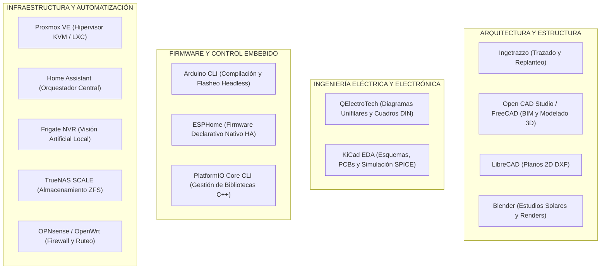

# Ecosistema y Toolchain de Software 100% Libre (FOSS)

> **Política del Proyecto:** Soberanía tecnológica, reproducibilidad y privacidad absoluta. Cero dependencia de formatos propietarios o herramientas de suscripción cerrada. Todos los diseños, cálculos, firmware y simulaciones se desarrollan exclusivamente con herramientas de **código abierto y estándares abiertos**.

---

## 1. Matriz de Software Libre por Especialidad Técnica



---

## 2. Herramientas de Diseño Arquitectónico, Civil y Mecánico 2D/3D

### 2.1. Ingetrazzo
* **Uso Principal:** Replanteo de obra, trazado de tuberías y redes de servicios, cálculo de pendientes hidráulicas y replanteo de cimentaciones sobre plano.
* **Formatos de Trabajo:** Archivos de trazado vectorial, exportación a DXF estándar.
* **Aplicación en el Proyecto:** Ubicación en planta de las zapatas, pendiente de colectores de saneamiento hacia el biodigestor y trazado de canalizaciones eléctricas en muros y losas.

### 2.2. Open CAD Studio / FreeCAD
* **Uso Principal:** Modelado paramétrico 3D de piezas mecánicas, ensamblajes de componentes y modelado de información de construcción (BIM / FreeCAD Arch/BIM Workbench).
* **Formatos Estándar:** `.FCStd` (formato nativo), `.step`, `.stp`, `.iges`, `.stl` (para manufactura o impresión 3D), e `.ifc` (estándar abierto BIM para coordinación de obra).
* **Aplicación en el Proyecto:**
  - Modelado y ensamblaje 3D del rotor helicoidal y mástil del **aerogenerador Archimedes MK9**.
  - Estructuras y perfiles de aluminio de soporte para paneles solares y termotanque.
  - Carcasa y soportes mecánicos del **lucernario astronómico cenital**.
  - Soportes y cajas antivandálicas para videoportero y pantallas de intercomunicación.

### 2.3. LibreCAD / QCAD Community
* **Uso Principal:** Delineación técnica 2D de alta precisión para plantas arquitectónicas, secciones de cimentación, alzados y detalles constructivos.
* **Formatos Estándar:** `.dxf` (Drawing Exchange Format) y `.dwg` libre.
* **Aplicación en el Proyecto:** Planos de distribución de habitaciones, replanteo de zapatas y cuadros de carpintería.

### 2.4. Blender (BIM & Sun Study)
* **Uso Principal:** Renders 3D de visualización arquitectónica, simulación del recorrido del sol (*Sun Position Plugin*) y análisis de sombras y flujo de luz sobre patios y la vitrina celeste.

---

## 3. Herramientas de Ingeniería Eléctrica y Electrónica

### 3.1. QElectroTech
* **Uso Principal:** Diseño asistido por computadora para diagramas eléctricos industriales y residenciales, esquemas unifilares, borneros y cuadros de distribución DIN.
* **Formatos Estándar:** Archivos `.qet` y exportación a PDF vectorial y DXF.
* **Simbología:** Librería de símbolos normalizados según normas **IEC 60617** y **NEMA**.
* **Aplicación en el Proyecto:**
  - Diagrama unifilar oficial del tablero principal (Acometida 25 mm², DPS, interruptor bipolar, diferencial 63A/30mA y disyuntores C10-C32).
  - Esquema multifilar de conexionado del inversor híbrido, caja combinadora (Combiner Box) y banco de baterías LiFePO4.
  - Esquemas de borneros de los relés de pared y actuadores de electroválvulas.

### 3.2. KiCad EDA
* **Uso Principal:** Suite completa para captura esquemática electrónica, simulación de circuitos analógicos/digitales mediante ngspice y diseño de placas de circuito impreso (PCB).
* **Formatos Estándar:** `.kicad_sch` (esquema), `.kicad_pcb` (ruteo de pistas), y exportación en capas Gerber RS-274X y archivos de perforación Excellon.
* **Aplicación en el Proyecto:**
  - Diseño de módulos electrónicos personalizados: placas con microcontrolador ESP32 para lectura de sondas de temperatura PT100/DS18B20 en colectores solares.
  - Interfaces de aislamiento optoacoplado para activación de electroválvulas de gas y agua.
  - Tarjetas de acondicionamiento de señal para transformadores de corriente (CT Clamps) y sensores de presión de biogás.

---

## 4. Herramientas de Firmware, Código Embebido y Microcontroladores

### 4.1. Arduino CLI
* **Uso Principal:** Herramienta oficial en línea de comandos para compilación, gestión de bibliotecas (*libraries*), núcleos (*cores*) de arquitectura (ESP32, AVR, STM32, RP2040) y flasheo automatizado de microcontroladores sin requerir IDEs gráficos pesados.
* **Integración:** Permite crear scripts bash o Makefile para compilar y cargar código de manera desatendida.
* **Comandos Clave:**
  ```bash
  # Instalación de core ESP32
  arduino-cli core install esp32:esp32
  
  # Compilación headless
  arduino-cli compile --fqbn esp32:esp32:esp32wrover sketch/
  
  # Carga por puerto serial o OTA
  arduino-cli upload -p /dev/ttyUSB0 --fqbn esp32:esp32:esp32wrover sketch/
  ```

### 4.2. ESPHome
* **Uso Principal:** Sistema operativo y framework de código abierto basado en YAML para microcontroladores ESP8266 y ESP32.
* **Ventaja:** Genera firmware optimizado en C++ nativo que se integra instantáneamente a Home Assistant mediante la API nativa de Home Assistant (más rápida y liviana que MQTT).
* **Aplicación en el Proyecto:**
  - Control de electroválvulas de corte de agua y gas.
  - Lectura de sensores ultrasónicos de nivel de agua de la piscina y cisterna.
  - Control de apertura del motor del lucernario cenital y monitoreo pluviométrico.
  - Nodos satélite de voz y audio bidireccional.

### 4.3. PlatformIO Core (CLI)
* **Uso Principal:** Entorno de desarrollo agnóstico de hardware para proyectos en C/C++ avanzados que requieran pruebas unitarias embebidas y gestión estricta de dependencias.

---

## 5. Plataforma de Servidores y Orquestación Central (100% Open Source)

1. **Hipervisor:** Proxmox VE (KVM + LXC bajo Debian Linux) con licencia libre AGPL v3.
2. **Núcleo Domótico:** Home Assistant OS / Container (Licencia Apache 2.0).
3. **Almacenamiento de Datos:** TrueNAS SCALE (Basado en Debian con sistema de archivos ZFS nativo de código abierto).
4. **Visión Artificial:** Frigate NVR (Apache 2.0) acelerado con bibliotecas abiertas de TensorFlow Lite / Edge TPU.
5. **Red y Ruteo:** OPNsense (Licencia BSD de 2 cláusulas) o OpenWrt (GPL).
6. **Telefonía e Intercomunicación:** Asterisk PBX (GPL v2) + go2rtc (WebRTC / RTSP server de código abierto).
7. **Bases de Datos y Métricas:** PostgreSQL / InfluxDB (Open Source) + Grafana para paneles analíticos de rendimiento energético.

---

## 6. Organización de Archivos en el Repositorio

Para mantener la interoperabilidad abierta, cada carpeta de componente almacenará sus diseños en las extensiones nativas del software libre:

| Carpeta Técnica | Software Utilizado | Extensiones de Archivos Soportadas |
| :--- | :--- | :--- |
| `00_diseno_arquitectonico_y_estructural/` | Ingetrazzo, LibreCAD, FreeCAD | `.dxf`, `.dwg`, `.FCStd`, `.step`, `.ifc` |
| `01_aerogenerador_archimedes_mk9/mecanico/` | Open CAD Studio / FreeCAD | `.FCStd`, `.step`, `.stl` |
| `07_tableros_distribucion_y_protecciones/electrico/` | QElectroTech, KiCad | `.qet`, `.kicad_sch`, `.pdf` vectorial |
| `*/electrico/` (circuitos y PCBs) | KiCad EDA | `.kicad_sch`, `.kicad_pcb`, `.gerber` |
| `*/control/` (firmware y automatización) | Arduino CLI, ESPHome | `.ino`, `.cpp`, `.yaml`, `.h` |

