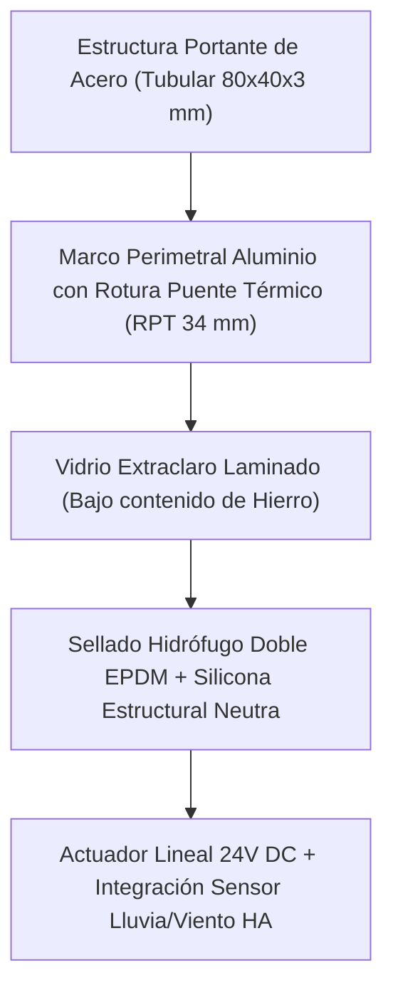

# NDT-02: Bioclimática, Ventilación Pasiva y Cúpula Astronómica Cenital

## 1. Criterios de Diseño Bioclimático Pasivo

La envolvente arquitectónica minimiza el consumo de climatización artificial aprovechando la geometría solar y las diferencias de presión térmica para la renovación del aire.

### 1.1 Orientación y Protección Solar de Huecos
- **Fachada Principal:** Orientación óptima Sur (en hemisferio norte) o Norte (en hemisferio sur) con tolerancia $\pm 15^\circ$.
- **Dimensionamiento de Aleros y Voladizos:**
  $$P_{alero} = \frac{H_{ventana}}{\tan(\beta_{verano})} \cdot 1.15$$
  - Permite el bloqueo del $100\%$ de la radiación solar directa durante el solsticio de verano ($\beta_{verano} \approx 65^\circ-75^\circ$) y el ingreso total de radiación para calefacción pasiva en el solsticio de invierno ($\beta_{invierno} \approx 25^\circ-35^\circ$).

### 1.2 Ventilación Natural por Efecto Chimenea (Tiro Térmico Pasivo)
La vitrina cenital en la parte superior del núcleo de escaleras y sala principal actúa como chimenea solar:

$$Q = C_d \cdot A_{abertura} \cdot \sqrt{2 \cdot g \cdot \Delta h \cdot \frac{T_{interior} - T_{exterior}}{T_{medio}}}$$

- **$C_d$:** Coeficiente de descarga ($0.65$).
- **$A_{abertura}$:** Área neta de ventilación cenital ($1.20\text{ m}^2$).
- **$\Delta h$:** Desnivel vertical entre tomas de aire inferiores (patios sombreados) y la cumbrera del lucernario ($6.50\text{ m}$).
- **Caudal de renovación pasiva:** $Q \ge 850\text{ m}^3/\text{h}$ con un gradiente térmico de apenas $\Delta T = 4^\circ\text{C}$, permitiendo refrigeración nocturna (free-cooling) sin encender compresores.

---

## 2. Ingeniería de la Vitrina / Lucernario Astronómico Cenital

Diseñado para cumplir una doble función: iluminación cenital difusa diurna y **observatorio estelar astronómico de alta claridad óptica nocturna**.

### 2.1 Especificaciones del Paquete de Acristalamiento
- **Composición:** Vidrio de seguridad $8\text{ mm} \text{ Extraclaro Templado} + 1.52\text{ mm PVB Acústico} + 8\text{ mm} \text{ Extraclaro Templado}$ (cámara $16\text{ mm}$ con $90\%$ gas Argón y vidrio interior $6\text{ mm}$ con capa bajo emisiva Low-E).
- **Vidrio Extraclaro (Low-Iron):** Transmisión lumínica visible $TL \ge 89\%$ (elimina el tinte verdoso del vidrio común para permitir astrofotografía y observación con telescopio).
- **Aislamiento Térmico:** Coeficiente $U_g \le 1.1\text{ W/m}^2\text{K}$.
- **Inclinación de la Cubierta:** $12^\circ$ a $15^\circ$ hacia el desagüe pluvial para evitar estancamiento de agua o polvo, garantizando máxima bóveda celeste visible cenitalmente.

### 2.2 Control Solar y Aislamiento Nocturno
- **Persiana Térmica Exterior Motorizada:**
  - Láminas de aluminio inyectadas con espuma de poliuretano de alta densidad ($75\text{ kg/m}^3$).
  - Cerrado automático en horas de insolación pico de verano para evitar sobrecalentamiento invernadero.
  - Apertura total programada al anochecer para observación astronómica y ventilación nocturna.
- **Micro-Actuadores de Ventilación Cenital:**
  - 2 actuadores lineales electromecánicos de $24\text{ V}$ DC con carrera de $300\text{ mm}$, fuerza de empuje de $1000\text{ N}$.
  - Cierre de emergencia automático ante lluvia detectado por sensor óptico piezoeléctrico RG-11 y velocidad de viento anemométrica superior a $35\text{ km/h}$.

---

## 3. Guía de Modelado FOSS

1. **FreeCAD (Part Design / BIM):**
   - Modelado del perfil de rotura de puente térmico y chapa de goterón perimetral de zinc/aluminio.
   - Ensamble del marco pivotante con bisagras de acero inoxidable AISI-316.
2. **Blender (Estudio de Sombras y Asoleamiento):**
   - Asignación de coordenadas geográficas precisas y fecha/hora mediante el addon *Sun Position*.
   - Renderizado con Cycles para verificar que la luz directa no cause deslumbramiento en áreas de trabajo.
