# NDT-03: Canalizaciones Normadas, Segregación EMI y Red de Fluidos (Gas Dual e Hidráulica)

## 1. Segregación Eléctrica y Canalizaciones de Telecomunicaciones

El tendido de canalizaciones garantiza inmunidad total ante interferencias electromagnéticas (EMI) y cumplimiento estricto de las normas internacionales **NFPA 70 (NEC Art. 300, 725 y 800)**, **TIA-569-E** y **NOM-001-SEDE**.

### 1.1 Reglas Físicas de Separación entre Potencia y Datos
1. **Distancia Mínima de Paralelismo:**
   - Entre canalizaciones de fuerza ($120\text{V} / 230\text{V} / 400\text{V}$ AC) y cables de datos (Cat6A, buses RS-485, 1-Wire, KNX): **$\ge 300\text{ mm}$ ($30\text{ cm}$)** en tramos paralelos continuos.
   - En proximidad a variadores de frecuencia, inversores solares o balastros: **$\ge 500\text{ mm}$**.
2. **Cruces de Canalizaciones:**
   - Cuando sea estrictamente indispensable que un ducto de señal cruce un ducto de potencia, el cruce debe ejecutarse en **ángulo recto estricto ($90^\circ$)**, nunca en diagonal ni compartiendo la misma caja de registro.
3. **Cajas de Registro y Derivación:**
   - Totalmente independientes para fuerza y baja tensión. En cuadros combinados (ej. cajas de pulsadores domóticos con relés), se exige una **barrera metálica divisoria conectada a tierra equipotencial**.

### 1.2 Factor de Ocupación / Llenado de Conduits ($Fill\ Factor$)
Para evitar estrangulamiento térmico y facilitar re-cableados futuros:
$$F = \frac{\sum d_i^2}{D_{interior}^2} \le 0.40 \quad (40\%)$$
- **Conduit de Potencia:** PVC Cédula 40 reforzado de $\phi 25\text{ mm}$ ($1"$) y $\phi 32\text{ mm}$ ($1\frac{1}{4}"$) para circuitos derivados.
- **Conduit de Telecomunicaciones / Sensores:** Tubería corrugada de doble capa libre de halógenos $\phi 25\text{ mm}$ directo a cada estancia en topología de estrella desde el patch panel del rack IT.

---

## 2. Red de Gas Dual (Comisión + Tanque Recargable/Biogás)

El sistema de gas opera con dos fuentes redundantes y corte automático de emergencia ante la menor fuga o evento sísmico.

```mermaid
flowchart TD
    G1["Línea Red Municipal / Comisión"] --> R1["Regulador Primario (2.8 kPa)"]
    G2["Tanque LP Recargable / Biogás"] --> R2["Regulador Secundario (2.8 kPa)"]
    R1 --> V_SEL["Válvula Selectora Motorizada 3 Vías"]
    R2 --> V_SEL
    V_SEL --> V_CORTE["Electroválvula de Seguridad Normalmente Cerrada (NC)"]
    V_CORTE --> MANIFOLD["Manifold de Distribución a Consumos (Cocina, Caldera, Generador)"]
    
    SENSORES["Detectores de Gas (Cocina, Sala Técnica, Exterior)"] -->|Interbloqueo Físico| V_CORTE
```

### 2.1 Especificaciones de Tubería y Válvulas
- **Material de Tubería:** Tubería de cobre rígido sin costura **Tipo L** unida con soldadura capilar de plata ($\ge 15\%$ Ag, punto de fusión $> 650^\circ\text{C}$) o tubería multicapa PE-AL-PE para gas certificada (presión máxima de prueba neumática: $10\text{ bar}$).
- **Electroválvula de Corte General:**
  - Válvula solenoide de latón de apertura manual y rearme eléctrico o biestable de impulsos ($12\text{V} / 24\text{V}$ DC), clasificada **ATEX Ex d**.
  - Enclavamiento físico directo mediante contacto seco desde los controladores de zona (cierre en $< 500\text{ ms}$ ante detección de metano $> 1000\text{ ppm}$ o GLP $> 500\text{ ppm}$).
- **Línea de Biogás:** Tubería de polietileno de alta densidad (PEAD PE100) desde el biodigestor séptico hacia filtro trampa de agua/condensados y lecho de óxido de hierro (desulfurizador de $H_2S$) antes de su inyección al colector de mezcla.

---

## 3. Red Hidráulica y Bucle de Recirculación de Agua Caliente (ACS)

### 3.1 Distribución en Estrella con Manifold Central
- Tubo PEX-a (polietileno reticulado con memoria térmica) con casquillo de prensado axial de latón DZR resistente a la desgalvanización.
- Cero empalmes ocultos bajo losa o muros; todas las uniones se concentran en colectores registrables.

### 3.2 Lazo Cerrado de Recirculación Térmica
- Línea de retorno aislada con coquilla elastomérica de $19\text{ mm}$ ($k = 0.035\text{ W/m}\cdot\text{K}$).
- Bomba circuladora síncrona de rotor húmedo y imanes permanentes ($24\text{ V}$ DC, consumo $\le 8\text{ W}$).
- **Lógica de Activación Domótica:** La recirculación no opera $24/7$ para evitar pérdidas térmicas. Se enciende por **demanda predictiva**: cuando los sensores de presencia en baños detectan ocupación matutina/nocturna, o ante un toque breve del pulsador de baño, funcionando durante 90 segundos hasta alcanzar $45^\circ\text{C}$ en el retorno.

---

## 4. Guía de Modelado FOSS

1. **QElectroTech:**
   - Diagramación esquemática de la red de tuberías de gas y trazado de los circuitos de alimentación de electroválvulas y sensores MQ.
2. **LibreCAD (Plantas de Instalaciones):**
   - Capas diferenciadas: `INST_GAS_COMISION` (magenta), `INST_GAS_LP_BIOGAS` (naranja), `INST_HIDR_FRIA` (azul), `INST_HIDR_CALIENTE` (rojo), `INST_ELECT_POTENCIA` (amarillo), `INST_DATOS_CAT6A` (verde).
   - Generación de planos constructivos para instaladores certificados.

