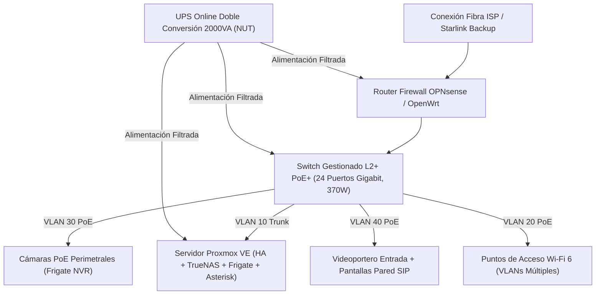

# NDT-05: Infraestructura IT, Segmentación de Red VLANs, Cámaras PoE e Intercomunicación SIP

## 1. Topología del Rack IT y Distribución de Potencia

El centro neurálgico de cómputo y conectividad se ubica en el cuarto técnico en un rack estándar de $19"$ y $24\text{U}$ de profundidad $800\text{ mm}$ con ventilación forzada termostatizada.

### 1.1 Especificaciones de Suministro Ininterrumpido (UPS)
- **Tecnología:** Online de Doble Conversión (VFI-SS-111) de $2000\text{ VA} / 1800\text{ W}$, onda senoidal pura sin tiempo de transferencia ($0\text{ ms}$).
- **Protocolo de Gestión:** Servidor de Network UPS Tools (NUT) vía USB/Ethernet.
- **Plan de Apagado Escalonado:**
  1. Corte eléctrico: Alimentación inmediata desde banco LiFePO4 / UPS.
  2. Batería UPS $< 30\%$: Envío de señales SSH para apagado ordenado de VMs no críticas en Proxmox.
  3. Batería UPS $< 15\%$: Desmontaje seguro de pools ZFS en TrueNAS y detención controlada del hipervisor.

---

## 2. Segmentación de Red en VLANs y Esquema de Direccionamiento

Para garantizar privacidad absoluta, inmunidad ante intrusiones e integridad de los flujos de seguridad, la red física se divide en subredes aisladas:

| VLAN ID | Nombre | Subred | DHCP / Asignación | Salida a Internet | Acceso Inter-VLAN |
| :--- | :--- | :--- | :--- | :--- | :--- |
| **VLAN 10** | **ADMIN_MGMT** | `10.10.10.0/24` | Estática | Sí | Acceso irrestricto a todas las VLANs mediante firewall stateful |
| **VLAN 20** | **IOT_DOMOTICS** | `10.10.20.0/24` | DHCP reservado | Restringida (Solo NTP/DNS) | Acceso exclusivo al broker MQTT y Home Assistant |
| **VLAN 30** | **CAMERAS_NVR** | `10.10.30.0/24` | Estática | **BLOQUEADA ($0\%$)** | Solo el servidor Frigate puede solicitar streams RTSP |
| **VLAN 40** | **INTERCOM_VOIP** | `10.10.40.0/24` | DHCP reservado | Bloqueada (Salida PBX) | Tráfico SIP/RTP directo a Asterisk y go2rtc con QoS prioritario |
| **VLAN 50** | **GUEST_WIFI** | `10.10.50.0/24` | DHCP dinámico | Sí | Solo acceso a Internet (aislamiento entre clientes habilitado) |

---

## 3. Sistema de Intercomunicación SIP / WebRTC y Videoportero

La intercomunicación residencial opera sobre un servidor **Asterisk PBX / Kamailio** local y **go2rtc** para streaming de video ultrarrápido con latencia sub-100ms.

### 3.1 Nodos del Sistema de Intercomunicación
1. **Videoportero de Entrada Principal (Exterior):**
   - Alimentación PoE 802.3af.
   - Sensor de imagen $2\text{K} / 4\text{MP}$ con lente gran angular $160^\circ$ e iluminación infrarroja invisible de $940\text{ nm}$ (sin luz roja visible que delate su ubicación).
   - Pulsador de llamada piezoeléctrico de acero inoxidable antivandálico IK10.
   - Procesador DSP con Cancelación de Eco Acústico (AEC) y supresión de ruido de viento.
   - Salida de relé seco conectada directamente a la cerradura electromagnética / cerradero de seguridad.
2. **Estaciones Interiores de Pared y Sobremesa (Multi-Estancia):**
   - Ubicadas en vestíbulo, cocina, sala de estar, dormitorio principal y despacho/estudio.
   - Pantallas táctiles IPS de $7"$ o $10"$ alimentadas por PoE o base de escritorio.
   - Compatibilidad nativa con protocolo SIP para llamada bidireccional punto a punto (ej. "Llamar a Cocina", "Llamada General / Voceo").
   - Integración del dashboard de Home Assistant en modo quiosco (*Kiosk Mode*).
3. **Monitores de Habitación de Bebé y Mascotas:**
   - Cámara PoE silenciosa de orientación fija con micrófono de alta sensibilidad MEMS.
   - Iluminación IR invisible a $940\text{ nm}$ (evita perturbar el sueño de bebés o la visión de perros/gatos).
   - Inferencia de audio local mediante modelo Edge-AI (clasificador acústico YAMNet / TFLite en Home Assistant) para alerta inmediata ante:
     - Detección de llanto de bebé.
     - Detección de ladridos o quejidos continuos de mascotas.
     - Sonido de rotura de cristales o golpes fuertes.

---

## 4. Guía de Puesta en Marcha FOSS

1. **Asterisk PBX (Contenedor Docker / Proxmox CT):**
   - Configuración de extensiones en `pjsip.conf`:
     - Ext. 101: Portero Entrada.
     - Ext. 201 a 205: Pantallas Interiores.
     - Ext. 301 a 304: Softphones en dispositivos móviles de los residentes (vía VPN WireGuard local).
2. **Frigate NVR + Coral TPU:**
   - Detección de personas y vehículos en tiempo real en los accesos antes de que toquen el timbre.
   - Previsualización automática de la cámara del portero en todas las pantallas activas cuando se detecta aproximación en el porche.

